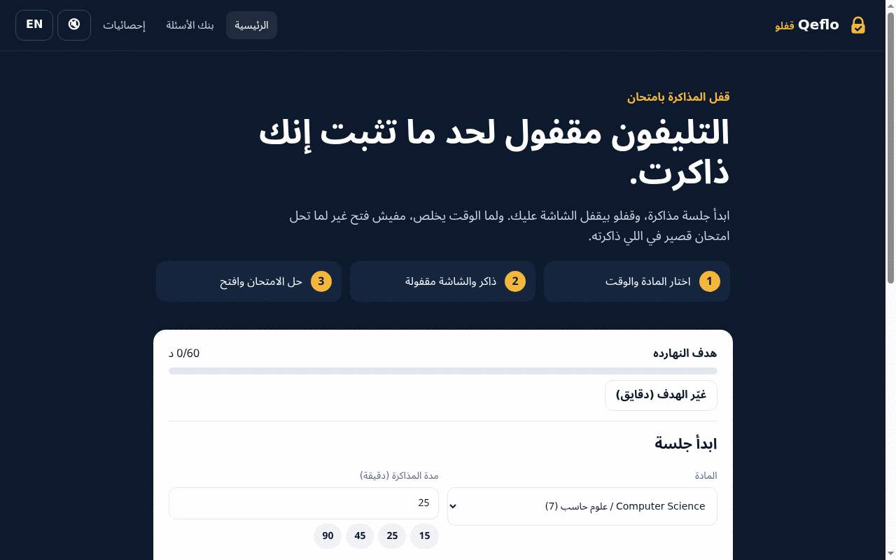
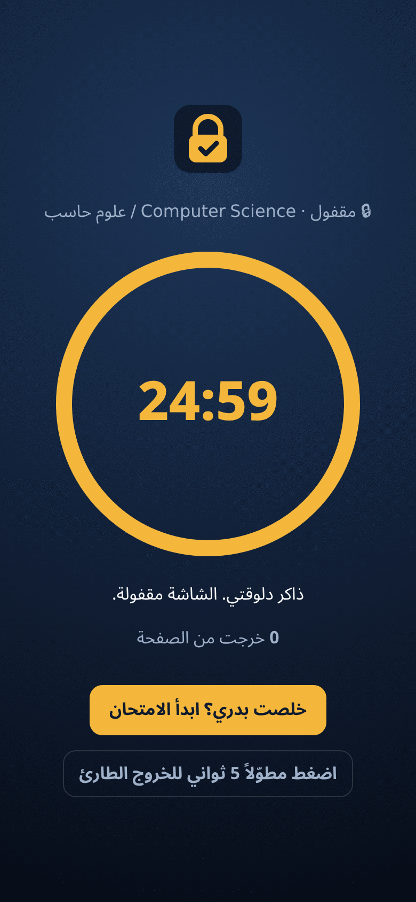
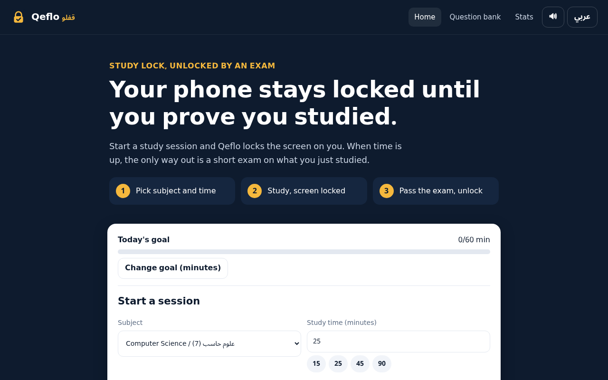
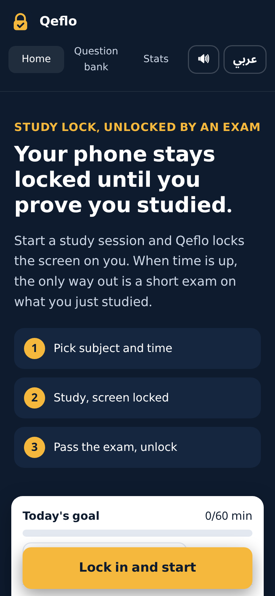
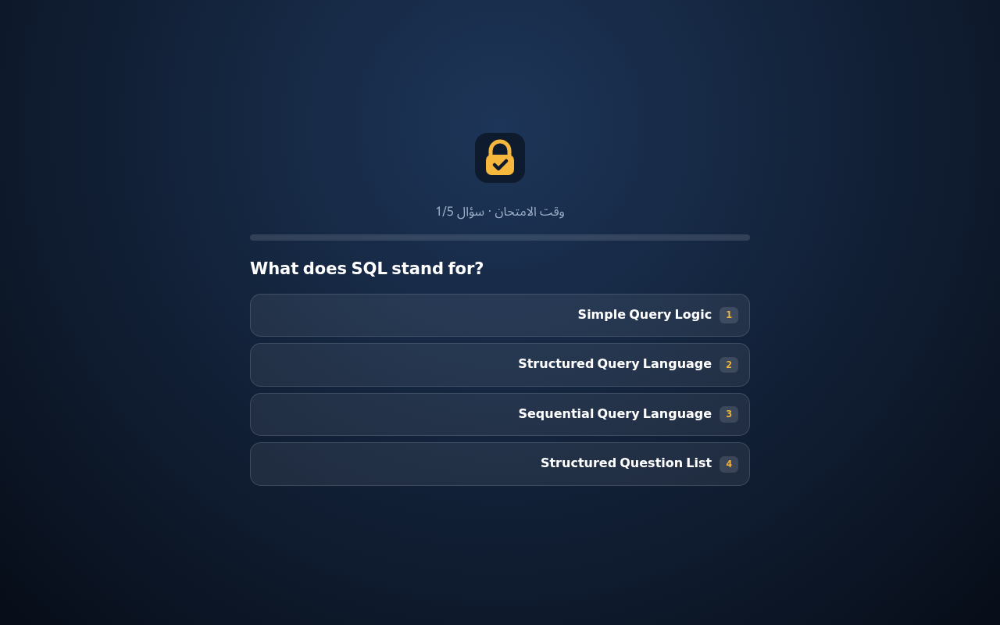
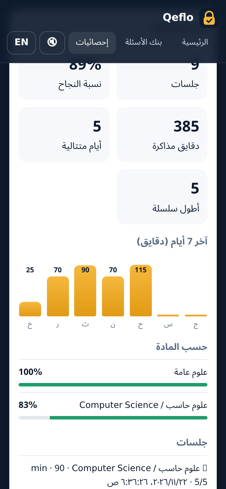

<div align="center">


# Qeflo (قفلو)

**A study lock that stays locked until you pass a short exam on what you just studied.**

[**Live demo**](https://yousefkhames.github.io/qeflo/) · [Report an issue](https://github.com/yousefkhames/qeflo/issues) · MIT licensed

Arabic and English · installable PWA · works offline · no account, no tracking

</div>

<p align="center">
  
  
</p>

## Screenshots

Captured from the live site (https://yousefkhames.github.io/qeflo/).

<p>
  
  
</p>

## Why

Study apps ask you to promise you will focus. Qeflo makes you prove you studied. You start a session, the screen locks with a countdown, and the only way out is an exam built from your own material. Pass the mark and it unlocks. Miss it and you get the correct answers, wait 20 seconds, and sit a fresh exam where your missed questions come up first.

## How it works

1. Pick a subject, a duration and a pass mark.
2. Study while the screen is locked. Leaving the page is counted, and in strict mode each exit adds 30 seconds.
3. Answer the exam to unlock. Results feed your stats and streak.

<p align="center">
  
  
</p>

## Features

- **Exam-gated unlock** with a configurable pass mark, retry delay and fresh questions each attempt
- **Notes to questions**: paste a summary and Qeflo generates multiple-choice (cloze) questions on your device. Arabic aware: letter normalisation, article stripping, same-script distractors
- **Study material** saved per subject, shown during the lock, and used for about 40% of each exam
- **Spaced retries**: questions you miss come up first next time
- **Strict mode**, press-and-hold emergency exit (5 s), session survives a page reload, screen wake lock
- **Stats**: sessions, pass rate, minutes studied, day streak and best streak, 7-day chart, accuracy per subject, daily goal, CSV export
- Question bank: add by hand, browse and delete, JSON import (merge) and export
- Arabic (RTL) and English, keyboard answers (1 to 4), screen reader labels, reduced-motion support, sound and haptics with mute
- Installable PWA with offline support

## Tech stack

- Frontend: plain HTML, CSS and JavaScript (no framework, no build step), service worker, Web Audio, Wake Lock and Vibration APIs
- Backend (optional): zero-dependency Node.js server that serves the app and syncs state per device to JSON files
- Hosting: GitHub Pages from `docs/`

## Run it

```bash
git clone https://github.com/yousefkhames/qeflo.git
cd qeflo
npm start            # http://localhost:3000 (optional sync backend)
```

Or serve `docs/` with any static host. Without the backend, everything is stored in the browser (`localStorage`).

## Project layout

```
docs/      the web app (index.html, app.js, style.css, sw.js, manifest, icons)
server/    optional Node.js server (static files + /api/state)
assets/    README screenshots
```

## Honest limits

- A web page cannot lock a whole phone. Qeflo locks its own page, warns before you leave, counts exits and adds time in strict mode. A determined user can close the tab.
- The question generator is rule based, not AI. It works best on clear, full sentences, and Arabic quality is good but not perfect.
- Data lives in your browser. Clearing site data erases it, so export a backup now and then.

## Roadmap

- Android app (Kotlin, foreground service and overlay) that blocks chosen apps until the exam is passed
- Spaced repetition scheduling, not just retry priority
- Shareable question banks for classmates
- Better Arabic stemming for distractors

## Related projects

Flashcard-gated app blockers such as Passlingo, ProcrastiLearn, AnkiBlock and Gatekeeper inspired the idea. Qeflo differs by gating on a full exam with a pass mark, generating that exam from your own notes, and running in a browser with an Arabic-first interface.

## License

MIT, see [LICENSE](LICENSE).


## Demo / portfolio project

Static GitHub Pages site. Data stays in your browser. Sample data is fictional and results are not professional, legal, medical or financial advice.

By Yousef Khames · من تطوير يوسف خميس
